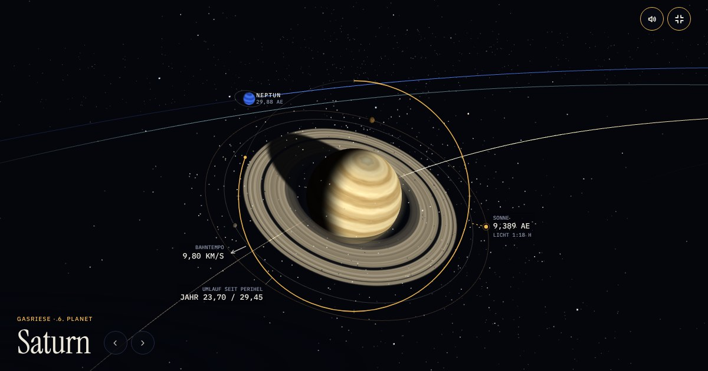

# Sonnensystem – eine Kamerafahrt

Animierte 3D-Reise durch das Sonnensystem im Browser, mit Sprecher und Musik: die Planeten an ihren für das
Datum berechneten Positionen, ein Flug durch die Wolken der Erde bis in ihren Kern, eine mögliche Kolonie auf
dem Mars und der Asteroidengürtel. Läuft auf dem Handy wie auf einem großen Monitor, in Deutsch, Englisch und Polnisch.

**Live:** https://sonnensystem.johannes-wanzek.de/



## Schnellstart

Es braucht nur Python 3, sonst nichts.

```
python tools/serve.py
```

Dann http://localhost:8080 öffnen. Die Seite wird bei jedem Neuladen frisch aus `src/sonnensystem.html`
gebaut: ändern, speichern, neu laden. Ein Doppelklick auf eine HTML-Datei reicht nicht, weil Browser Ton,
Karten und Modelle nicht von der Festplatte laden.

## Aufbau

```
src/sonnensystem.html    die ganze Seite in einer Datei: Stil, Markup, Programm (three.js r128, kein Framework)
site.json                Adresse, Titel, Beschreibung, Verweise auf Impressum und Datenschutz
public/                  wird unverändert veröffentlicht
  voice/, audio/           Sprecher (15 Clips je Sprache; voice/en/, voice/pl/), Musik (drei Stücke) und audio/sfx/ (13 Effekte) als MP3
  img/                     Karten von Erde, Mars und Jupiter
  models/                  3D-Modelle (GLB)
  vendor/                  three.js, GLTFLoader, Schriften – alles lokal, nichts kommt von fremden Servern
  LIZENZEN.txt             Quellen und Lizenztexte
tools/
  build.py                 baut dist/ (und die Testseite)
  serve.py                 lokaler Entwicklungsserver
  test/run.js              Prüfung im Browser ohne Fenster, mit Bildschirmfotos
  audio/                   Aufbereitung von Sprecher und Musik (Lautheit, Zeitmarken, Schleife)
  models/                  Modelle verkleinern und für claude.ai-Artefakte umwandeln
docs/
  produktion.md            wie Sprecher, Musik und Modelle entstanden sind
  sprechertext.<Sprache>.json   der Sprechertext (de, en, pl) mit den Stichworten für die Kamerafahrt
.github/workflows/pages.yml   baut und veröffentlicht bei jedem Push auf main
CLAUDE.md                Projektnotizen für die Arbeit mit einem KI-Assistenten
```

## Bauen und veröffentlichen

```
python tools/build.py            # -> dist/
python tools/build.py --apache   # -> dist/ mit .htaccess für einen Apache-Webspace (z. B. STRATO)
```

**GitHub Pages:** Ein Push auf `main` genügt. Die Action in `.github/workflows/pages.yml` baut `dist/` und
veröffentlicht es. In den Repo-Einstellungen unter *Pages* steht als Quelle „GitHub Actions“ und als eigene
Domain `sonnensystem.johannes-wanzek.de`.

**Domain:** Bei STRATO zeigt die Subdomain per CNAME auf `johanneswanzek.github.io`
(Domainverwaltung → Subdomain → DNS → CNAME-Record). Das Zertifikat für HTTPS stellt GitHub aus.

**Eigener Webspace statt GitHub Pages:** `python tools/build.py --apache` und den Inhalt von `dist/` per SFTP
hochladen. Die Seite besteht nur aus statischen Dateien.

**Einstellungen** stehen in `site.json`. Wer dort `impressum` und `datenschutz` einträgt (Adresse oder Pfad),
bekommt die Verweise im Dialog „Quellen“ (letzter Knopf der Leiste unten).

## Sprachen

Die Seite gibt es in Deutsch, Englisch und Polnisch. Beim ersten Besuch entscheidet die Sprache des Browsers
(alles andere als Deutsch oder Polnisch bekommt Englisch), danach die letzte Wahl über den Knopf oben rechts.
Eine Adresse mit `?lang=de`, `?lang=en` oder `?lang=pl` legt die Sprache fest und eignet sich zum Verlinken.

Alle Texte stehen deutsch in `src/sonnensystem.html`; die Übersetzungen liegen daneben in der Tabelle `TR`
(Schlüssel ist der deutsche Text). Titel und Beschreibung der Seite je Sprache stehen in `site.json` unter `i18n`.

## Bedienung

| Eingabe | Wirkung |
| --- | --- |
| Leertaste | Tour starten und anhalten |
| Pfeil links, Pfeil rechts | voriger und nächster Halt |
| F | Vollbild |
| M | Ton: Musik und Sprecher, nur Sprecher, aus |
| Ziehen, Mausrad oder zwei Finger | Ansicht drehen und zoomen |

## Testen

Die Prüfung läuft in einem Chrome ohne Fenster (Playwright) und legt Bildschirmfotos nach `.test/shots/`.

```
cd tools/test && npm install && npx playwright install chromium && cd ../..

node tools/test/run.js 390 760 start focus:8 wait:8000 shot:saturn-handy
node tools/test/run.js 1920 1080 start focus:5 wait:5000 stage:1 wait:8000 mbt:45 wait:2000 shot:mars-landung
node tools/test/run.js --dist 1280 720 go wait:6000 shot:start      # prüft dist/ so, wie es veröffentlicht wird
node tools/test/run.js --lang=pl 390 760 start focus:4 wait:5000 shot:erde-polnisch
```

Alle Schritte stehen im Kopf von `tools/test/run.js`. Jede Anfrage an eine fremde Adresse gilt als Fehler.

## Quellen und Lizenzen

- **Karten und 3D-Modelle:** NASA (Blue Marble, Nachtlichter, Mars, Jupiter; Modelle aus „NASA 3D Resources“).
  Die NASA hat dieses Projekt weder geprüft noch unterstützt sie es.
- **Sprecher, Musik und Effekte:** mit künstlicher Intelligenz erzeugt bei ElevenLabs (elevenlabs.io), die Musik mit
  Eleven Music, die Effekte mit Sound Effects.
- **Technik:** three.js r128 (MIT). Schriften: Instrument Serif, IBM Plex (SIL Open Font License).

Die vollständigen Angaben und Lizenztexte stehen in [`public/LIZENZEN.txt`](public/LIZENZEN.txt), Einzelheiten
zur Entstehung in [`docs/produktion.md`](docs/produktion.md).

Für den eigenen Quelltext dieses Repos ist bisher keine Lizenz festgelegt.

### Vor einer Veröffentlichung zu prüfen (keine Rechtsberatung)

- **ElevenLabs:** Stimme und Musik dürfen kommerziell nur genutzt werden, wenn sie in einem bezahlten Tarif
  erzeugt wurden. Im kostenlosen Tarif gilt: nicht kommerziell und mit Nennung von „elevenlabs.io“ (für die
  Musik „Eleven Music“) im Titel.
- **NASA-Logo:** Das Wohnmodul trägt in seiner Textur das NASA-Logo, so wie die NASA das Modell
  veröffentlicht hat. Das Logo ist gesondert geschützt; für eine werbliche Nutzung wäre das zu klären.
- **Impressum und Datenschutz:** Für öffentlich erreichbare Seiten in Deutschland in der Regel nötig, sobald
  die Seite nicht rein privat ist. Die Seite selbst setzt keine Cookies und bindet keine fremden Dienste ein.
