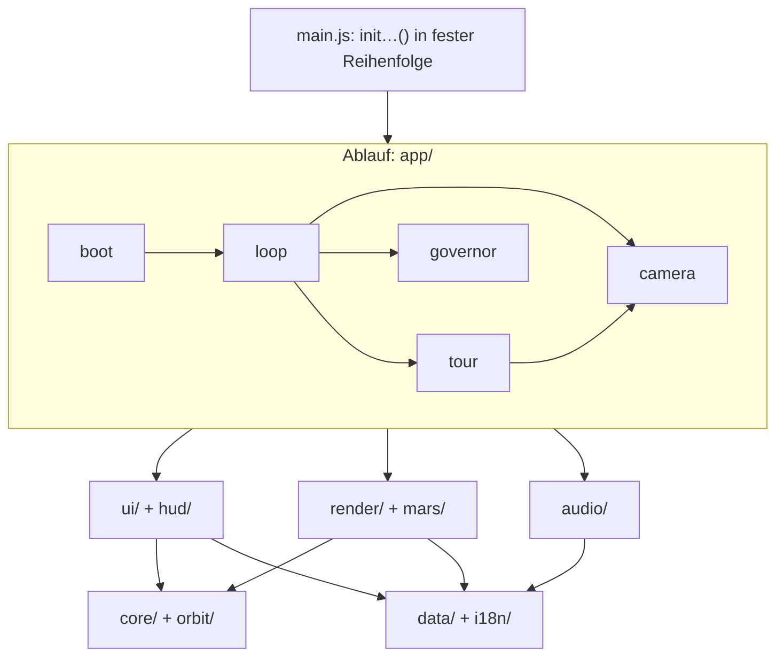
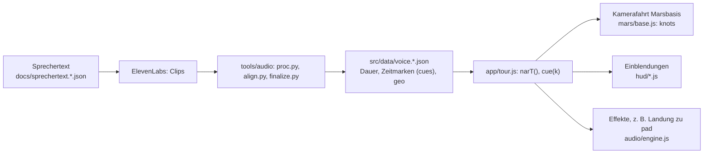

# Architektur: Schichten, Datenfluss, Bau-Ziele

Überblick über den Aufbau der Seite „Sonnensystem – eine Kamerafahrt“ für Menschen und KI-Agenten. Die vollständige, aus dem
Quelltext erzeugte Liste aller Module steht in [`modulkarte.md`](modulkarte.md); Begriffe deutsch ↔ Bezeichner in
[`glossar.md`](glossar.md); die Entscheidungen dahinter in [`adr/`](adr/README.md). Lokale Regeln je Bereich stehen in den
`AGENTS.md` der Ordner (`src/mars/`, `src/audio/`, `src/render/`, `src/hud/`, `src/i18n/`, `tools/audio/`, `tests/`).

## Überblick

Eine statische Seite: HTML (`index.html`), CSS (`src/styles/`) und JavaScript als ES-Module (`src/`), gebündelt mit Vite
(ADR 0002). three.js r128 kommt aus npm (ADR 0001). Es gibt keinen Server-Code. Die Seite zeigt eine Reise durch elf Halte
(`BODIES`: Übersicht, Sonne, die acht Planeten und der Asteroidengürtel) mit Sprecher, Musik und Effekten in drei Sprachen. Zwei
Szenen werden gezeichnet: die Weltraumszene (Maßstab gestaucht, Einheit AE-nah) und die Marsoberfläche (eigene Szene, Einheit
Meter). Darüber liegt ein 2D-Overlay (Canvas) mit den Messmarken und das DOM der Bedienung.

## Schichten und Abhängigkeitsrichtung

Von unten nach oben; ein Modul importiert aus tieferen Schichten und aus seiner eigenen.

| Schicht | Ordner | Aufgabe |
| --- | --- | --- |
| Grundlagen | `src/core/`, `src/orbit/` | Hilfen (`util.js`), gemeinsamer Zustand (`state.js`), Bauziel (`target.js`), Gerätehinweis (`device.js`), Kepler-Bahnen (reine Funktionen) |
| Daten | `src/data/`, `src/i18n/` | Himmelskörper (`BODIES`), Sprecher-Zeitmarken je Sprache (JSON), Sprache und Übersetzung |
| Darstellung | `src/render/`, `src/mars/` | Renderer, Nachbearbeitung (`POST`), prozedurale Oberflächen (`SURF`), Shader, Weltraumszene, Marsbasis (`MB`) |
| Ton | `src/audio/` | Web Audio (`AU`): Musik, Sprecher, Effekte |
| Oberfläche | `src/ui/`, `src/hud/` | DOM-Bedienung, Layout (`measure`), Eingaben, Messmarken auf dem Overlay |
| Ablauf | `src/app/` | Tour (`focus`, `setStage`, `narrate`), Kamera, Auflösungsregler, Schleife (`frame`), Start (`boot`) |
| Einstieg | `src/main.js` | lädt die Stile und ruft die `init…()`-Funktionen in fester Reihenfolge auf |
| Test | `src/testing/` | Prüfhaken, nur im Testmodus |

Die Richtung ist nicht streng: Es gibt Zyklen zwischen `app/`, `hud/`, `ui/` und `render/` (zum Beispiel braucht `hud/` die
Tour, `app/loop.js` ruft `hud/` auf). Das ist erlaubt, solange die Importe nur Funktionen und Objekte betreffen, die erst
zur Laufzeit benutzt werden; Werte auf oberster Ebene eines Moduls dürfen nicht von einem Zyklus abhängen (Fehler „Zugriff
vor der Initialisierung“). Das Diagramm der Ordnerabhängigkeiten (`npm run docs:map`) steht in [`modulkarte.md`](modulkarte.md) und ist dort
automatisch erzeugt.

## Start und gemeinsamer Zustand

- **`init…()`-Reihenfolge:** Alles, was beim Laden des Moduls schon DOM, Renderer oder andere Module braucht, steht in
  `init…()`-Funktionen (`initDom`, `initRenderer`, `initScene`, `initPost`, `initBase`, `initTour`, `initLoop`, `initBoot` …). `src/main.js`
  ruft sie in der festen Reihenfolge auf, die das frühere Skript hatte. Liefert `initRenderer()` `false` (kein WebGL), endet der Start.
  Wer ein Modul mit `init…()` ergänzt, trägt es in `main.js` an der passenden Stelle ein.
- **Gemeinsamer Zustand:** ES-Module dürfen Variablen nur im eigenen Modul zuweisen. Was mehrere Module **schreiben** (`W`, `H`,
  `topH`, `botH`, `narStart`, `surfOn`, `veil`, `mbT`, `soundMode` …), liegt im Objekt `S` in `src/core/state.js` (`S.surfOn`).
  Was nur gelesen wird, wird exportiert; Zustand mit einem klaren Besitzer (`cur`, `stage`, `tour`, `dwell` in `app/tour.js`) bleibt dort
  und wird über Funktionen geändert (`focus`, `setStage`, `setTour`).
- **Bauziel:** `src/core/target.js` liefert zur Bauzeit `TARGET` (`'site'` oder `'artifact'`), `SITE_CFG` (Angaben aus `site.json`,
  nur Website) und `MODEL_EXT` (`.glb` oder `.json`). Der Rest des Codes fragt `TARGET` und `SITE_CFG`, nie die Umgebung.
- **Testmodus:** `import.meta.env.MODE === 'test'` (`vite build --mode test`) schaltet in `app/boot.js` die Prüfhaken
  (`src/testing/hooks.js`: `window.__t`) und an wenigen Stellen die Haken `window.__mbt`, `window.__clk`, `window.__cam` (`app/loop.js`, `mars/base.js`) und
  `window.__au` (`audio/engine.js`) ein. In der veröffentlichten Seite gibt es sie nicht.

## Datenfluss: das Bild folgt dem Ton

`narT()` ist die Sprecherzeit des laufenden Clips (Sekunden seit `S.narStart`), `cue(k)` die Zeitmarke eines Stichworts aus
`VOICE[narId]` (`1e9`, wenn es fehlt). Einblendungen und die Kamerafahrt über die Marsbasis hängen an diesen Marken, nicht an festen
Zeiten; die Kamerafahrt rechnet relativ zu den Stichworten und passt sich der Länge jeder Sprachfassung an. Ohne Ton läuft ein
Kapitel mit Marken trotzdem in voller Länge (`narrate` setzt `dwell` aus der Clipdauer). Die Werte in `voice.<sprache>.json` schreibt
`tools/audio/finalize.py`; von Hand nur ändern, wenn auch der Clip dazu passt (ADR 0005).

## Laufende Schleife (`app/loop.js`, `frame`)

Je Bild: Zeit und Tour fortschreiben, Kamera (`app/camera.js`: `desired`, `camAt`) zum Ziel des Halts führen, Szenenwechsel zwischen
Weltraum und Marsoberfläche mit Staubschleier (`S.veil`, `S.surfOn`), die passende Szene über `POST.render` zeichnen, Messmarken
(`hud/index.js`: `drawHUD`) auf dem Overlay. Der Auflösungsregler (`app/governor.js`) misst die Bilddauer und stellt die
Renderauflösung nach.

## Abschnitte je Körper

Erde hat 0 Planet, 1 Nahansicht mit Ozeanen und Kontinenten, 2 Aufbau im Schnitt. Mars hat 0 Planet, 1 Basis. `setStage(n)`
(`app/tour.js`) wechselt, die Tour läuft sie der Reihe nach durch. Jeder Abschnitt hat einen eigenen Clip (`earth`, `earth_geo`,
`earth_core`, `mars`, `mars_base`; die übrigen Halte heißen wie ihr `id`).

## Layout und Auflösung

- **Layout (`ui/layout.js`, `measure()`):** setzt `ui` (Maßstab), `wide` (Querformat: Uhr und Titel in den Ecken, der Körper nutzt die
  volle Höhe; die Übersicht bleibt über dem Titel), `topH`/`botH` (freie Fläche) und `guard` (Flächen von Uhr und Titel, denen
  Beschriftungen ausweichen). Alle Größen der Oberfläche hängen an der CSS-Variable `--u` (1 px auf dem Handy, bis etwa 2 px auf
  großen Monitoren), die Messmarken auf dem Overlay-Canvas am selben Faktor `ui`. `drawHUD` rechnet in Einheiten von `ui` und
  stellt `W`, `H`, `topH`, `botH` nach dem Zeichnen zurück.
- **Auflösung (`app/governor.js`):** `PR.v[0]` Weltraum, `PR.v[1]` Marsoberfläche, in Bildpunkten je CSS-Pixel. `govern()` misst
  einmal je Sekunde die Bilddauer, senkt bei Rucklern, prüft, ob die Absenkung geholfen hat (sonst nimmt es sie zurück), und versucht
  bei flüssigem Lauf einen Schritt nach oben. `DESKTOP` (`core/device.js`: Maus, große Texturen) schaltet größere Schattenkarte, mehr
  Steine und Überabtastung auf Monitoren mit einfacher Pixeldichte frei.

Die Einzelheiten zu Nachbearbeitung, Marsbasis, Ton, Messmarken und Sprachen stehen in den `AGENTS.md` der jeweiligen Ordner
(`src/render/`, `src/mars/`, `src/audio/`, `src/hud/`, `src/i18n/`).

## Bau-Ziele

Alle drei Ziele bauen aus denselben Quellen (`vite.config.js`, `tools/artifact/build.mjs`).

| Ziel | Befehl | Ergebnis | Besonderheiten |
| --- | --- | --- | --- |
| Website | `npm run build` | `dist/` | `TARGET = 'site'`; Kopfangaben aus `site.json`; Schriften, Modelle (`.glb`), Bild und Ton lokal aus `public/`; der Bau bricht ab, wenn im Ergebnis eine fremde Adresse steht (`tools/build/check-foreign.mjs`) |
| Artefakt | `npm run build:artifact` | `dist-artifact/sonnensystem.html` und `dist-artifact/begleitdateien.txt` | `TARGET = 'artifact'`; Fragment ohne `<html>`, `<head>`, `<body>`; Skript samt three.js und Stil eingebettet; Schriften von Google Fonts; Modelle als `models/<name>.json` (glTF mit eingebetteten Daten, erzeugt von `tools/models/embed.mjs` nach `.artifact/models/`) |
| Test | `npm run build:test` (`vite build --mode test`) | `.test/` | Prüfhaken aktiv, nicht minifiziert, `public/` wird nicht kopiert; ohne die volle Desktop-Ausstattung, außer mit `VITE_DESK=1` |

## Was ändere ich wo?

| Aufgabe | Stelle |
| --- | --- |
| Sichtbaren Text ändern oder ergänzen | deutscher Text im Code oder in `index.html` (`data-t`); Übersetzung in `src/i18n/en.json` und `pl.json` (Schlüssel = deutscher Text); `npm run test:unit` prüft die Vollständigkeit |
| Neuen Halt ergänzen | Eintrag in `BODIES` (`src/data/bodies.js`), Clip und Eintrag in `voice.<sprache>.json`, Szene in `src/render/scene/`, Messmarken in `src/hud/`, Texte in den Übersetzungen, Test für die Anzahl der Halte in `tests/e2e/` |
| Shader oder Oberfläche eines Planeten | `src/render/shaders/` (GLSL), `src/render/surfaces.js` (`SURF`, gebackene Texturen), `src/render/scene/planets.js` |
| Nachbearbeitung, Bloom, Tonemapping | `src/render/post.js`, `src/render/shaders/post.js` |
| Marsbasis (Gelände, Bauten, Fahrzeuge, Kamerafahrt) | `src/mars/base.js`, `src/mars/layout.js` (Daten), `src/mars/shaders.js` (GLSL) |
| Musik, Effekte, Absenken unter der Stimme | `src/audio/engine.js`, Daten in `src/audio/tracks.js`, Dateien in `public/audio/` |
| Sprecher neu oder neue Sprache | `docs/produktion.md`, `tools/audio/`, `src/data/voice.<sprache>.json`; kostet Credits |
| Messmarken und Beschriftungen | `src/hud/` (ein Modul je Körper, Grundformen in `draw.js`) |
| Layout, Maßstab, Querformat | `src/ui/layout.js`, `src/styles/layout-wide.css`, `src/styles/` |
| Eingaben, Tastatur | `src/ui/controls.js` |
| Auflösung, Leistung auf Handys | `src/app/governor.js`, `src/core/device.js` |
| Bahnmechanik, Positionen | `src/orbit/kepler.js` (mit Unit-Test) |
| Bau, Artefakt, Prüfung auf fremde Adressen | `vite.config.js`, `tools/artifact/build.mjs`, `tools/build/check-foreign.mjs` |
| Tests | `tests/e2e/` (Playwright), `tests/unit/` (Vitest), `tools/shots/` (Bildschirmfotos) |

## Bekannte technische Schuld

Die Aufteilung folgte den Abschnitten des früheren Monolithen und ändert das Verhalten nicht. Daraus bleibt:

- **Große Closures:** `MB` (`src/mars/base.js`, mit `MB.build` und der gesamten Szene), `AU` (`src/audio/engine.js`) und `SURF`
  (`src/render/surfaces.js`) sind je ein großes Objekt mit vielen lokalen Hilfen. Sie sind die größten Module und für gezieltes
  Lesen zu lang (nach der Formatierung: `mars/base.js` 1840 Zeilen, `audio/engine.js` 689, `render/surfaces.js` 220; zum Vergleich `render/post.js` 227). Vorschlag für den nächsten Schnitt: `mars/base.js` in Gelände (`hgt`, Boden), Himmel, Bauten, Fahrzeuge und
  Animationen (`anim[]`), Kamerapfad (`knots`, `OBST`) und Teilchen (`Puffs`); `audio/engine.js` in Musik (Überblendung der
  Stücke), Effekte (`SFX`, `playS`) und Sprecher (`say`, Absenken); `render/surfaces.js` in eine Datei je Körper.
- **Richtgröße:** Der Richtwert von etwa 500 Zeilen je Modul ist nach der Formatierung (ADR 0007, Commit 3b9d53d) nur noch von `mars/base.js` und `audio/engine.js` überschritten; die Zeilenzahlen der Modulkarte sind seitdem aussagekräftig.
- **Zustand `S`:** `S` ist ein untypisiertes Objekt (`Record<string, any>`). Typisieren (JSDoc `@typedef`) ist der nächste Schritt
  für `checkJs`.
- **Zyklen:** `app/`, `hud/`, `ui/` und `render/` importieren einander; das trägt, solange nur Funktionen betroffen sind.
- **Prüfhaken:** `window.__t` und weitere Haken sind im Code als Abfragen von `import.meta.env.MODE` verstreut.
