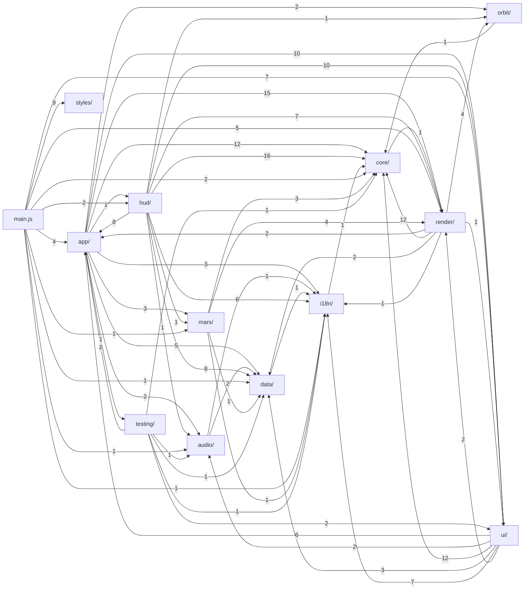

# Modulkarte von `src/`

Diese Datei wird von `tools/docs/modulkarte.mjs` aus dem Quelltext erzeugt (`node tools/docs/modulkarte.mjs`); nicht von Hand ändern.
Zweck = erste Kopfkommentarzeile jedes Moduls, Exporte und Abhängigkeiten stammen aus den `export`- und `import`-Zeilen.
Die Erklärung der Schichten und des Datenflusses steht in `docs/architecture.md`, Begriffe in `docs/glossar.md`.

Stand: 50 Module, 3741 Zeilen JavaScript.

## Abhängigkeiten zwischen den Ordnern

Pfeil A → B: Ein Modul in A importiert aus B (die Zahl ist die Anzahl der Importe). Zyklen laufen nur über Funktionen, die erst zur Laufzeit aufgerufen werden.

## Module

### src/

| Modul | Zweck | Exporte | Zeilen |
| --- | --- | --- | --- |
| `main.js` | Einstieg: Stil laden und die Module in der Reihenfolge des früheren Skripts starten | – | 67 |

### src/app/

| Modul | Zweck | Exporte | Zeilen |
| --- | --- | --- | --- |
| `app/boot.js` | Start: Karten und Oberflächen vorbereiten, Szene bauen, Modelle nachladen | `initBoot` | 88 |
| `app/camera.js` | Kamera: Sollposition je Körper und Abschnitt (desired), Kamerapfad, Eingriffe des Nutzers | `initCamera`, `camAt`, `dPos`, `dTgt`, `desired`, `fromOff`, `fromTgt`, `pos`, `tgt`, `tmp`, `tmp2`, `user` | 67 |
| `app/governor.js` | Auflösungsregler PR/govern: misst die Bilddauer und passt die Renderauflösung an | `PR`, `govern`, `prLimits`, `setPR` | 47 |
| `app/loop.js` | Schleife frame(): Kamera, Szenenwechsel mit Staubschleier, Rendern | `initLoop`, `frame` | 180 |
| `app/tour.js` | Tour: Erzählzeit (narT, cue), focus, setStage, narrate, showInfo, Schritte, Zeitraffer, Beginn | `initTour`, `BELT`, `EARTH`, `MARS`, `begin`, `cue`, `cur`, `cutS`, `durCur`, `dwell`, `focus`, `narId`, `narT`, `rollDir`, `setSpeed`, `setStage`, `setTour`, `speedIdx`, `stage`, `stageCount`, `step`, `tour`, `travel` | 118 |

### src/audio/

| Modul | Zweck | Exporte | Zeilen |
| --- | --- | --- | --- |
| `audio/engine.js` | Ton (AU): Web Audio, Musikstück als Schleife, Sprecher-Clips, Effekte, Absenken der Musik unter der Stimme | `initEngine`, `AU` | 293 |
| `audio/tracks.js` | Tondaten: Hauptstück (MUSIC, BEAT), Zusatzstücke je Halt (TRACKS), Effekt-Samples (SFX) | `BEAT`, `MUSIC`, `SFX`, `TRACKS` | 17 |

### src/core/

| Modul | Zweck | Exporte | Zeilen |
| --- | --- | --- | --- |
| `core/device.js` | Geräteklasse: DESKTOP schaltet die teure Ausstattung frei (Maus, große Texturen) | `initDevice`, `DESKTOP` | 16 |
| `core/state.js` | Gemeinsamer veränderlicher Zustand: Variablen, die mehrere Module schreiben (ES-Module erlauben | `S` | 42 |
| `core/target.js` | Ziel des Baus als Bauzeit-Konstanten (gesetzt in vite.config.js per define): | `TARGET`, `SITE_CFG`, `MODEL_EXT` | 13 |
| `core/util.js` | Kleine Hilfen: DOM-Abfrage $, Winkel, clamp, Glättung und Easing, reduzierte Bewegung | `initUtil`, `$`, `DEG`, `TAU`, `clamp`, `easeIO`, `easeO`, `easeQ`, `reduced`, `ss` | 20 |

### src/data/

| Modul | Zweck | Exporte | Zeilen |
| --- | --- | --- | --- |
| `data/bodies.js` | Himmelskörper (BODIES) mit Bahnelementen, Monden und Texten; Halley, Szenenradius, Zeitraffer | `BODIES`, `DWELL0`, `HALLEY`, `RMAX`, `SPEEDS` | 74 |
| `data/voice.js` | Sprecher-Clips je Sprache: Dauer und Zeitmarken (voice.<sprache>.json, geschrieben von tools/audio/finalize.py) | `initVoice`, `VOICE` | 23 |

### src/hud/

| Modul | Zweck | Exporte | Zeilen |
| --- | --- | --- | --- |
| `hud/base.js` | Beschriftungen der Stationen der Marsbasis | `baseHUD` | 29 |
| `hud/belt.js` | Messmarken des Asteroidengürtels | `beltHUD` | 21 |
| `hud/draw.js` | Messmarken: Grundformen auf dem Overlay-Canvas (Linien, Beschriftungen, Maßstäbe) | `initDraw`, `DIM`, `FONT`, `GROUP_T`, `INK`, `MARKS`, `MONO`, `SUNC`, `corner`, `d0`, `d1`, `dimension`, `disc`, `gauge`, `hits`, `label`, `lightShort`, `lightTxt`, `line`, `nf0`, `nf1`, `nf2`, `nf3`, `onScreen`, `rects`, `rgba`, `ring`, `rv`, `s0`, `s1`, `scr`, `screenDir`, `side` | 130 |
| `hud/earth.js` | Messmarken der Erde: Ozeane und Kontinente, Aufbau im Schnitt, Wolkenflug | `initEarth`, `cloudFX`, `coreHUD`, `geoHUD` | 111 |
| `hud/index.js` | drawHUD: zeichnet die Messmarken des aktuellen Körpers | `drawHUD` | 91 |
| `hud/overview.js` | Messmarken der Übersicht | `overviewHUD` | 33 |
| `hud/planet.js` | Messmarken eines Planeten und seiner Monde | `planetHUD` | 90 |
| `hud/sun.js` | Messmarken der Sonne | `sunHUD` | 37 |

### src/i18n/

| Modul | Zweck | Exporte | Zeilen |
| --- | --- | --- | --- |
| `i18n/index.js` | Sprache: LANG, LOC, Übersetzung tr/fill (Schlüssel ist der deutsche Text), setLang. Wörterbücher in en.json, pl.json | `initI18n`, `LANG`, `LANGS`, `LOC`, `fill`, `setLang`, `tr` | 48 |

### src/mars/

| Modul | Zweck | Exporte | Zeilen |
| --- | --- | --- | --- |
| `mars/base.js` | Marsbasis (MB): eigene Szene auf der Oberfläche in Metern – Gelände, Bauten, Fahrzeuge, Kamerafahrt, Teilchen | `initBase`, `MB` | 632 |
| `mars/layout.js` | Feste Daten der Marsbasis: ebene Flächen, Hindernisse der Kamera, Wohnmodule, Dunst (HZ), Krater, Teilchenfarben | `AST_YAW`, `CRATERS`, `DUST`, `FLAT`, `HAB`, `OBST`, `ROVER_YAW`, `STEAM` | 14 |
| `mars/shaders.js` | GLSL der Marsszene: Luftperspektive und Bodendetail (MB_GLSL), Himmel (SKY_FS) | `MB_GLSL`, `SKY_FS` | 39 |

### src/orbit/

| Modul | Zweck | Exporte | Zeilen |
| --- | --- | --- | --- |
| `orbit/kepler.js` | Bahnmechanik: Kepler-Bahnen aus Bahnelementen für ein Datum (reine Funktionen) | `basis`, `place`, `solve` | 34 |

### src/render/

| Modul | Zweck | Exporte | Zeilen |
| --- | --- | --- | --- |
| `render/bake.js` | Backen auf der Grafikkarte: Shader in eine Textur rechnen (bake, bakeFlat) | `initBake`, `bake`, `bakeFlat`, `nextFrame` | 51 |
| `render/canvas-textures.js` | Kleine Canvas-Texturen: Ringe, Lichtpunkte, Strahlen; Wertrauschen | `hash`, `radialTex`, `raysTex`, `ringTex`, `vnoise` | 61 |
| `render/post.js` | Nachbearbeitung (POST): HDR-Ziel mit MSAA, Bloom in Stufen, Belichtung, Tonemapping, Vignette, Korn | `initPost`, `POST` | 121 |
| `render/renderer.js` | WebGL-Renderer und Fehleranzeige, wenn WebGL fehlt | `initRenderer`, `fail`, `renderer` | 22 |
| `render/scene.js` | Weltraumszene: Szene, Kamera, gemeinsame Hilfen (Punktwolken, Halo, Bahnlinien, Marker), geteilte Texturen | `initScene`, `add`, `blackTex`, `camera`, `halo`, `marker`, `orbitLine`, `points`, `rays`, `scene` | 65 |
| `render/surfaces.js` | SURF: prozedurale Oberflächen der Himmelskörper als Shader-Bausteine | `initSurfaces`, `SURF` | 164 |

### src/render/scene/

| Modul | Zweck | Exporte | Zeilen |
| --- | --- | --- | --- |
| `render/scene/backdrop.js` | Hintergrund: Sterne und Milchstraße | `buildBackdrop` | 48 |
| `render/scene/extras.js` | Zusätze der Szene: Komet Halley, Kuipergürtel, Lichtpuls | `buildExtras` | 30 |
| `render/scene/minor.js` | Kleinkörper: Vesta, Asteroiden des Gürtels und Felsbrocken beim Durchflug | `buildMinor`, `flightRocks`, `rockGeo`, `scatterFlight`, `setVesta` | 70 |
| `render/scene/planets.js` | Planeten mit Atmosphäre, Wolken, Ringen, Monden und Bahnen | `buildPlanet` | 83 |
| `render/scene/sun.js` | Sonne mit Korona, Halo und Strahlen | `buildSun` | 34 |

### src/render/shaders/

| Modul | Zweck | Exporte | Zeilen |
| --- | --- | --- | --- |
| `render/shaders/bake.js` | GLSL der gebackenen Oberflächen (Rauschen, Höhen, Erde) | `BAKE_LIB`, `BAKE_MAIN`, `BAKE_VS`, `EARTH_GEO` | 57 |
| `render/shaders/post.js` | GLSL der Nachbearbeitung: Vertex-Shader des Vollbild-Rechtecks | `VSQ` | 7 |
| `render/shaders/space.js` | GLSL der Weltraumszene: Planeten, Wolken, Schnitt, Halo, Sonne, Ringe, Bahnen | `CLOUD_FS`, `CORONA_FS`, `CORONA_VS`, `HALO_FS`, `LAYER_FS`, `ORBIT_FS`, `ORBIT_VS`, `PLANET_FS`, `RING_FS`, `SUN_FS`, `VS` | 200 |

### src/testing/

| Modul | Zweck | Exporte | Zeilen |
| --- | --- | --- | --- |
| `testing/hooks.js` | Prüfhaken für Tests (window.__t). Nur im Testmodus (vite build --mode test) aufgerufen | `installTestHooks` | 20 |

### src/ui/

| Modul | Zweck | Exporte | Zeilen |
| --- | --- | --- | --- |
| `ui/controls.js` | Eingaben: Knöpfe, Tastatur, Zeiger (Ziehen, Kneifen, Rad) | `initControls`, `initControls2`, `ptrs` | 69 |
| `ui/credits.js` | Dialog „Quellen“, Impressum und Datenschutz (nur Website), Titel und Beschreibung je Sprache | `initCredits`, `creditsEl` | 39 |
| `ui/dom.js` | Elemente der Seite, Übersetzen der festen Texte (data-t, aria-label) | `initDom`, `app`, `c2`, `canvas`, `caption`, `clockEl`, `elBlurb`, `elDate`, `elEff`, `elKind`, `elName`, `elSpeed`, `elSr`, `fx`, `hudEl`, `hudR`, `labelsEl`, `loader`, `navEl`, `rail`, `startEl`, `tourBtn`, `tourIcon` | 34 |
| `ui/fullscreen.js` | Vollbild und Kinoansicht | `initFullscreen`, `cine`, `fullBtn` | 50 |
| `ui/language-menu.js` | Sprachwahl oben rechts | `initLanguageMenu`, `langBtn`, `langMenu`, `openLang` | 28 |
| `ui/layout.js` | Layout: measure() setzt Maßstab ui, Querformat wide, freie Flächen und Schutzzonen | `availH`, `dpr`, `guard`, `gx`, `measure`, `shiftTarget`, `ui`, `wide` | 51 |
| `ui/rail.js` | Leiste der Himmelskörper und Beschriftungen in der Szene | `initRail` | 27 |
| `ui/sound.js` | Tonknopf, Hinweise (toast), Tonmodus | `initSound`, `setSound`, `showSound`, `soundBtn` | 36 |

## Daten und Stile

| Datei | Inhalt |
| --- | --- |
| `data/voice.de.json` | Sprecher: Dauer und Zeitmarken je Clip, `geo`: Einblendzeiten der Ozeane und Kontinente (geschrieben von `tools/audio/finalize.py`) |
| `data/voice.en.json` | Sprecher: Dauer und Zeitmarken je Clip, `geo`: Einblendzeiten der Ozeane und Kontinente (geschrieben von `tools/audio/finalize.py`) |
| `data/voice.pl.json` | Sprecher: Dauer und Zeitmarken je Clip, `geo`: Einblendzeiten der Ozeane und Kontinente (geschrieben von `tools/audio/finalize.py`) |
| `i18n/en.json` | Wörterbuch (deutscher Text → Übersetzung) |
| `i18n/pl.json` | Wörterbuch (deutscher Text → Übersetzung) |
| `styles/base.css` | Stil |
| `styles/dialog.css` | Stil |
| `styles/fullscreen.css` | Stil |
| `styles/hud.css` | Stil |
| `styles/language-menu.css` | Stil |
| `styles/layout-wide.css` | Stil |
| `styles/nav.css` | Stil |
| `styles/rail.css` | Stil |
| `styles/start.css` | Stil |
